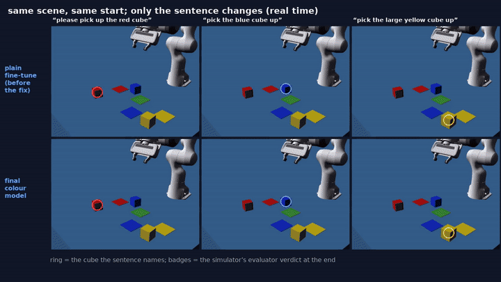
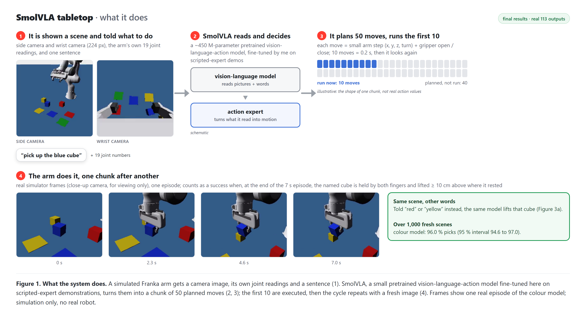
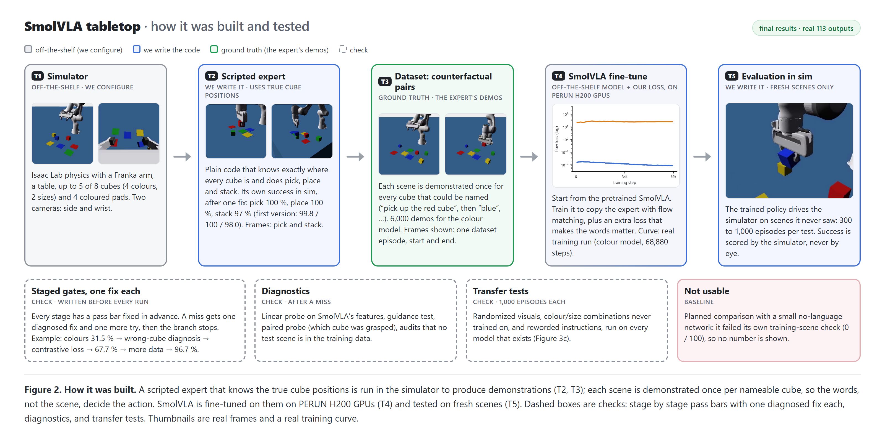
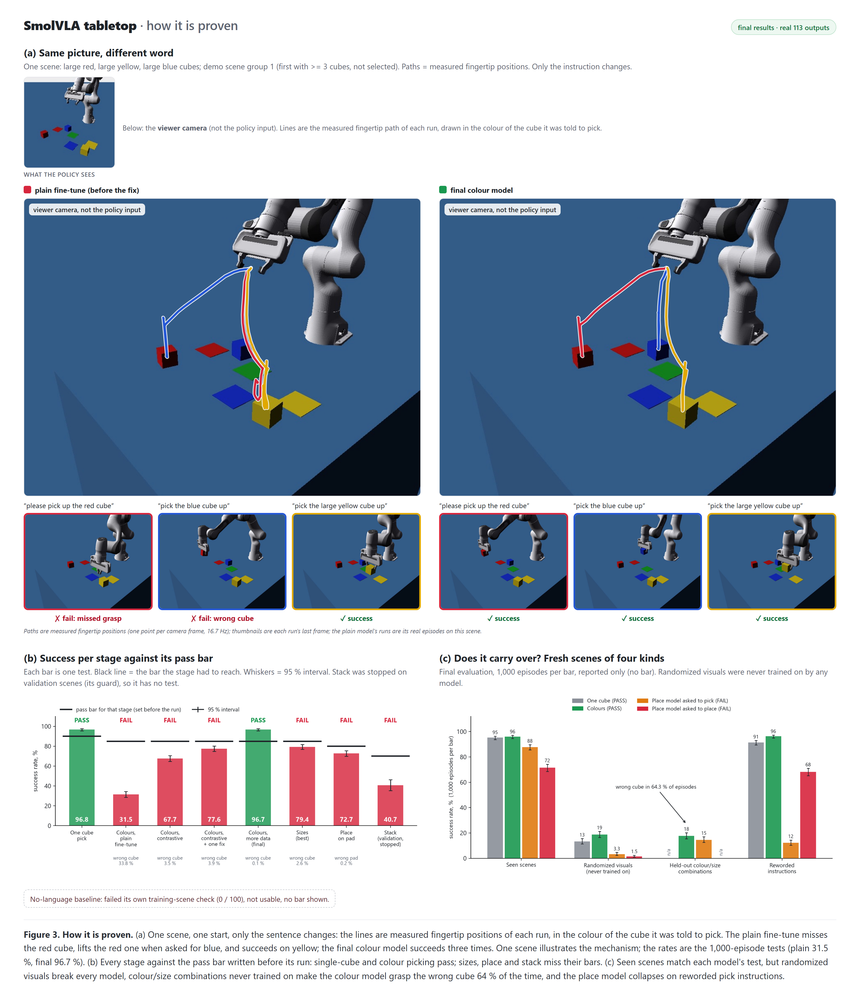

# franka-arm-vla — fine-tuning a small VLA to follow typed instructions (simulation)

A simulated Franka arm in Isaac Lab is told, in plain English, which cube to pick, where to put it, or what to stack it
on. The policy is **SmolVLA** (a ~450 M-parameter pretrained vision-language-action model, `lerobot/smolvla_base`),
fine-tuned here on demonstrations from a scripted expert, one stage at a time, each stage judged once against a pass bar
written before its run. **Result:** picking one cube (96.8 %) and picking the cube named by its colour among 2–4 cubes
(96.7 %) passed; adding sizes (79.4 %, bar 85), placing on a named pad (72.7 %, bar 80) and stacking (40.7 % on
validation, bar 70) did not. Plain fine-tuning ignored the colour word (31.5 %, a random-cube pattern); what fixed it
was training data in which every scene is shown once per nameable cube plus an instruction-contrastive loss. The
remaining failures are motor precision (grasp centring, releases, drops), not choosing the wrong cube. Simulation
only; no real robot. Compute: 178.95 H200 GPU-hours (+0.40 for the demo video's renders).



**[▶ Watch the full demo (4:52)](https://matus012.github.io/franka-arm-vla/)** (plays in the browser; GitHub cannot
show the mp4 in the file view)

**Demo video (4 min 52 s): [`media/113_demo.mp4`](media/113_demo.mp4)** — for each skill: what the robot was told,
the success rule quoted from the evaluator, the headline rate, the first 16 episodes from unseen demo scenes (not
selected, real time, the evaluator's verdict on each), and one episode full size with what the policy itself sees.
Chapters are also in `media/clips/`.

| skill (one model per stage) | told, e.g. | success rate (judged once) | bar | verdict |
|---|---|---|---|---|
| One cube: pick it up | “pick up the cube” | **96.8 %** [95.5, 97.7] (1,000 unseen test episodes) | ≥ 90 % | **PASS** |
| Colours: pick the cube named by its colour | “pick up the blue cube” | **96.7 %** [95.4, 97.6] (1,000 unseen test episodes) | ≥ 85 % | **PASS** |
| Colours and sizes: "the small red cube" | “pick up the small red cube” | **79.4 %** [76.8, 81.8] (1,000 unseen test episodes) | ≥ 85 % | **FAIL** |
| Place the named cube on the named pad | “put the red cube on the green pad” | **72.7 %** [69.9, 75.4] (1,000 unseen test episodes) | ≥ 80 % | **FAIL** |
| Stack the named cube on another cube | “stack the blue cube on the red cube” | **40.7 %** [35.3, 46.3] (300 validation episodes, training stopped by its guard) | ≥ 70 % | **FAIL** |

The no-language baseline network failed its own training-scene check (0 / 100) and gives no usable comparison.

## How it works





## Does it really use the words, and where does it break?



Concept cards (flow matching, action chunking, counterfactual pairs, the contrastive hinge, the linear probe, staged
gates): [`figures/cards.png`](figures/cards.png).

## What failed and why

- **Sizes (79.4 %).** The model understood the size words (the named cube in 95.0 % of its grasps), but in crowded
  scenes with up to 5 cubes the arm sometimes swung into the table or closed beside the cube.
- **Place (72.7 %).** The named cube in 289 / 289 grasps and the named pad in 246 / 246 releases; the misses were
  off-centre grasps, late or early releases and cubes dropped on the way. Its one extra training round made it worse
  (75.0 → 64.0 % on validation) and was stopped by its guard.
- **Stack (40.7 % on validation).** About half of its episodes dropped the cube; training was stopped by its guard at
  75 % of the schedule.
- **Transfer (final evaluation, 1,000 fresh scenes each, reported only):** randomized table colour / lighting breaks every
  model (none was trained on it); colour-size combinations never used as targets make the colour model grab another
  cube it was trained to pick (17.7 %); the place model asked to pick in other words mostly picks the cube up and sets
  it down (12.2 %).

## Reproduce

- **Environments** (pins in `uv.lock`, `policy/uv.lock`, `policy/VERSIONS.md`): sim venv — Python 3.12, torch 2.10.0
  cu130, Isaac Lab 3.0.0b2.post1 in lightweight mode (`uv sync`); policy venv — LeRobot 0.6.1 (`cd policy; uv sync`).
  The training container / SLURM scripts used on the cluster are in `hpc/`.
- **Tests:** `.venv/Scripts/python -m pytest tests` (sim side, GPU-free).
- **Evaluate a checkpoint** (exactly as the gates did; 128 parallel envs):
  `python scripts/eval_policy.py --policy smolvla --ckpt <checkpoint>/pretrained_model --stage s2a --split train --visual nominal --episodes 1000 --seed <seed> --envs 128 --image-size 224 --n 10 --cube-yaw-max-deg 15 --out results/<name>.json`
- **Demo video:** add `--record` (viewer-only camera + the evaluator's signals), then
  `python scripts/demo_facts.py` (cards from the evaluator constants + result JSONs) and `python scripts/demo_compose.py`;
  `python scripts/demo_gates.py` checks the video against the records.
- **Figures:** `figures/README.md`.
- **Data / training:** `scripts/collect.py` (scripted expert), `scripts/export_dataset.py` (LeRobot v3 dataset),
  `vla_policy/train_smolvla.py` (fine-tune, incl. the contrastive loss in `vla_policy/contrastive.py`); the exact
  per-stage commands are the steps files in `hpc/steps/`.

## Not released

- **Model weights and datasets** are not published (size, and they are only meaningful with this exact simulator setup);
  everything needed to regenerate them is here.
- Isaac Sim / Isaac Lab assets (incl. the Franka model) are not redistributed; see `THIRD_PARTY.md`.

## Full record

Everything below is the project's original running record (stages, gates, disclosures). `GATES.md` holds every
pre-registered gate and RESULT, `REPORT.md` the cumulative report, `reports/` one report per task.

### 113_vla_tabletop — project record

**Status (2026-10-27): the project has ended.** Passed: 0A, 0B, 0C (every data set), Stage 1 (one cube, variant V15:
pick 96.8 %), Stage 2M (pick the named cube among 2-4 colours: 96.7 %). Failed: Stage 2 merged (22.8 %), redesign (a)
(early abort), 2a attempts 0 and 1 (36.8 / 31.5 %), Stage 2R and its one fix (67.7 / 77.6 %: grounding fixed, grasp
precision not); sizes (2b after its one fix 68.1 %, round 2 79.4 %); 3A place (test 72.7 %, pick retention 90.2 %; its
one fix was stopped by its guard at 64.0 % on validation); 3B stack (stopped at 75 % of training, 40.7 % on validation;
no fix). Never run: the Stage 4 SmolVLA seeds (3A kill as written) and pi0.5 (dropped). The no-language baseline failed
its own overfit check and is "not a useful reference in 113". A final evaluation of the models that exist (task 010,
reported only) is below. No number in this file is estimated; source of every number: the RESULT lines and the 010
evaluation read in `GATES.md`, `results/*.json` and the reports in `reports/`.

**The short version.**
- **Motor skill: learned.** On one cube the arm approaches, grips square and lifts: 96.8 %.
- **Language: at first absent.** With 2-4 cubes the plain fine-tune chose a cube about as a scene-only policy would:
  success fell with the cube count (2a attempt 1: 49.6 / 27.0 / 16.8 % for 2 / 3 / 4 cubes), and a shuffled
  instruction scored about the same as the true one (21 vs 19 of 100). Training the text layers (2a attempt 0) and
  paired scenes (2a attempt 1) did not change that.
- **Diagnosis (task 003, not an attempt):** the colour word is in the features the action expert reads (linear probe
  100 % vs about 40 % shuffled control), but the first action chunk barely depends on it (instruction effect 0.10 x the
  start-noise effect). Reading: the objective / data, not the text path (`reports/2026-10-25-003-grounding-diagnosis.md`).
- **Guidance probe (task 004, not an attempt):** amplifying the instruction at sampling time did nothing: pick 28.7 /
  29.7 / 29.0 / 26.7 % at w = 1 / 2 / 4 / 8 (`reports/2026-10-25-004-guidance-probe.md`).
- **Stage 2R fixed the choice.** An instruction-contrastive hinge on the flow loss (the same noisy action chunk scored
  under another cube's instruction must fit worse by a margin): wrong-cube 34 -> 3.5 %, the named cube in 93.6 % of
  grasps (paired probe, chance 35 %), step-2 instruction / noise ratio 0.10 -> 2.2. The cost was grasp precision:
  pick 67.7 %, 77.6 % after its one fix (`reports/2026-10-25-005-stage2r.md`).
- **Stage 2M passed colours.** More paired data (6,000 demos) and 2x the steps at half the learning rate, same loss:
  pick 96.7 %, wrong-cube 0.1 %, the named cube in 99.5 % of grasps (`reports/2026-10-26-006-stage2m.md`).
- **Sizes, place and stack failed mostly on motor precision; grounding was measured high where probed (sizes, place).** Sizes: 79.4 % with the
  named cube in 95.0 % of grasps; misses are wild reaches and closes beside the cube in crowded scenes
  (`reports/2026-10-26-008-sizes-round2.md`). Place: 72.7 %, with the named cube in 289 / 289 grasps and the named pad in
  246 / 246 releases; misses are releases and transit drops. Stack: 40.7 % on validation, no probe; wrong target 7.3 % at
  c075 and the failures looked at mostly motor (`reports/2026-10-27-009-stage3.md`).

A simulated Franka Panda sits at a table with up to 5 of 8 cubes (red / green / blue / yellow, small / large) and 4
coloured pads. You type an instruction ("put the red cube on the green pad", "stack the small blue cube on the large
red one") and the arm has to do it from two camera images, its own joint readings and the text. The policy is
SmolVLA (`lerobot/smolvla_base`), fine-tuned on demonstrations from a scripted expert; it was to be compared with
pi0.5 (dropped, see below) and with a small no-language network that is handed the task as perfect labels. The point
is to learn how a VLA works and to see whether language really changes behaviour. Honest numbers on held-out
combinations, reworded instructions and randomized visuals are the deliverable, not just the seen-task score.
Simulation only; the code is public, model weights and datasets are not (see "Not released" above).

## What the robot sees and does

- **Inputs:** side camera + wrist camera (RGB), 19-dim state (7 arm + 2 finger joint positions, the same 9 velocities,
  gripper width), and the instruction text (the baseline gets 4 labels instead: task, colour, size, destination).
- **Image size and chunking, two phases.** 0A-0C and Stage 1 attempts 0-1: 128 px images (the smallest size that
  passed the camera gate 0A.4) and N = 20. From the Stage 1 redesign on (every later stage and the final evaluation):
  224 px and N = 10.
- **Banned inputs:** object poses in any form, contact forces, privileged phase signals. `tests/test_banned_inputs.py`
  enforces a 19-dim whitelist (garbage in the privileged fields must leave the executed actions bit-identical).
- **Action:** 5 dims, Cartesian arm deltas dx, dy, dz, dyaw in [-1, 1] (1 cm / 3 deg per step, through IK with the
  hand held vertical) + a binary claw (executed as > 0.5). Control at 50 Hz.
- **Chunking:** the policy is queried every N control steps and the first N actions of its chunk (SmolVLA predicts 50)
  are executed open loop. Cameras refresh every 3 control steps with 1 frame of latency.

## The task family

- **World:** 8 cubes = 4 colours x 2 sizes (small 4.8 cm, large 6.0 cm edge, same density), 4 coloured pads, 1-5 cubes
  on the table per episode, all four pads always present (so the scene alone does not reveal the task). From Stage 1
  redesign #2 on, cubes spawn with yaw within +-15 deg.
- **Tasks:** `pick` ("pick up the small blue cube", success = held >= 10 cm up), `place` ("put the red cube on the
  green pad", resting on the pad, released, gripper clear), `stack` ("stack the red cube on the blue cube", resting
  on the bottom cube, released, stable for 1 s).
- **Instructions:** several templates per task; every instruction names exactly one cube (and one destination),
  and the size is stated whenever another cube on the table shares the colour (unit-tested for uniqueness).
- **Held out (never manipulated in training, disjointness unit-tested):** two cubes (green-large, yellow-small) are
  never a pick / place / stack-top target (they appear as distractors or stack bottoms); 3 (cube, pad) place pairs and
  3 (top, bottom) stack pairs are never trained; a separate set of reworded **paraphrase** templates ("grab the red
  cube", "set it down on ...", "pile ... on ...") is disjoint from the training templates.

## Pipeline

```
scripted expert (privileged, true poses; DLS IK, hand vertical)
   -> HDF5 episodes (frames at camera ticks, state, clean label + executed action, sigma-0.1 demo noise)
   -> LeRobot dataset v3.0 (h264 4:4:4 crf 14, one row per 50 Hz step, local only)
   -> SmolVLA fine-tune on PERUN (H200; bf16 autocast, fp32 trainable weights)
   -> policy server (own venv, strict fp32, stateless, batched) <-- localhost bridge --> Isaac Lab sim (Newton physics)
   -> closed-loop evaluation (128 parallel envs, fixed test seeds) -> JSON + close-up frames -> GATES.md
```

Two venvs talk only over the bridge (`vla_common/protocol.py`): the sim venv (Python 3.12, torch 2.10.0+cu130,
Isaac Lab 3.0.0b2.post1 in lightweight mode, no Isaac Sim) and the policy venv (LeRobot 0.6.1, same torch pin).
Interfaces are fixed in `docs/CONTRACT.md`.

## How it was run

- **Staged gates, written before the runs.** Each stage has pass bars, early-abort signals, a pre-written fallback and
  checkpoint-pick rules in `GATES.md`, committed before the run. Bars and budgets do not move; a failed gate gets its
  diagnosed fix and one new attempt, then the branch stops. New stages after a kill (Stage 1 redesigns, Stage 2R,
  Stage 2M, sizes round 2) were approved by the owner and are disclosed as such.
- **Smart test length.** 300 test episodes; if the result is more than 5 points from the bar it is decided, otherwise
  the test is extended to 1,000. Final evaluations always use 1,000. Test seeds are used once; checkpoints are picked on
  separate validation seeds.
- **Audits.** Every RESULT must name the close-up frames that were looked at. A consultant checks each gate against
  the JSON, git timestamps (gate committed before the run) and frames. Instruments are mutation-tested (detectors,
  tests, held-out audit).
- **Budget:** laptop <= 20 h; PERUN <= 200 H200 GPU-h (hard cap, raised by the owner: 100 -> 130 on 2026-10-03, 130 ->
  160 on 2026-10-25 with 180 allowed on the consultant's projection, 180 taken up on 2026-10-26, 180 -> 200 on
  2026-10-27, "up the limit to 200h"). Spent: PERUN 178.95 H200-h (010 evaluations 3.32 + videos 0.49 included; see
  `hpc/JOBS.md`, `000_infra/hpc_usage.md`); laptop 8.07 h (laptop rows of `ops/gpu_log.csv`).

## Results

Every row below is a RESULT line in `GATES.md`. "Not run" = the gate was never reached.

### Stage 0A - scene and expert (all PASS)

| gate | bar | result |
|---|---|---|
| 0A.1 scripted grasp holds the cube | >= 95 % of 300 trials per size | small 96.6 % (966/1,000), large 97.1 % (971/1,000) |
| 0A.2 expert (fixed expert, attempt 1) | pick >= 95, place >= 90, stack >= 85 % | pick 100 % (1,000/1,000), place 100 % (300/300), stack 97.3 % (292/300); wrong-object, slam, early close 0. (Attempt 0: 99.8 / 100 / 98.0 %.) These are the expert ceilings. |
| 0A.3 chunk timing (attempt 2) | within 3 points of the unchunked expert | N = 20 chosen: diffs pick +0.1, place 0.0, stack -0.3 points (1,000 paired each); N = 5 and 10 also pass. An upper bound only (see disclosures). |
| 0A.4 cameras | cube visibility >= 90 %, wrist sees target >= 80 %, pads visible >= 90 % | H = 128: worst cube 97.3 %, wrist 98.9 %, worst pad 97.3 % (224 and 256 also pass) |

### Stage 0B - pipeline (PASS overall)

| gate | bar | result |
|---|---|---|
| 0B.1 export round trip | columns exact, PSNR >= 35 dB, chunks exact | 0 column mismatches over 7,000 rows; PSNR min 36.4 dB; chunks and pad masks exact |
| 0B.2 bridge | complete, batch-invariant, right frame at each query | B = 1/16/64 complete; invariance 2.3e-6; 108/108 queries correct; server p50 0.71 / 1.89 / 7.29 s on the laptop |
| 0B.3 overfit (10 demos, fixed states) | >= 80 % success | attempt 0: 36/100, **VOID** as an instrument finding (see below); its re-run with the fixed expert: **FAIL 65/100**; attempt 1 (batch 64, the one fix): **PASS 99/100** |
| 0B.4 required tests | all pass, mutants killed | sim 320 passed, policy 339 passed, 7/7 mutants killed |
| 0B.5 container + first H200 job | bridge works on H200, decode identical | PASS (job 95678): torchcodec decode bit-identical to pyav on 14,000/14,000 images |
| 0B.6 throughput | measured, plan written | SmolVLA bs 64: 0.00364 GPU-s/sample frozen, 0.00654 with the vision encoder unfrozen |

### Stage 0C - bulk demos (all sets PASS)

| set | kept demos (exported) | expert success (Wilson 95 %) |
|---|---|---|
| s1 single cube pick | 500 | 98.0 % (96.6-98.8) |
| s2 pick among 2-5 cubes | 2,000 | 97.7 % (97.0-98.2) |
| s3a place | 2,000 | 100 % (99.8-100) |
| s3b stack | 2,000 | 95.2 % (94.2-96.0) |
| s4r randomized-visuals mix (Stage 4, grey-table palette; used by the baseline only) | 2,000 | pick 98.7 / place 100 / stack 97.9 % (per task) |
| 2a paired scenes (attempt 1: 799 layouts, each with every cube as the target) | 2,000 | 98.1 % (2,390 / 2,436) |

Held-out audit on the exported data: 0 violations. 0.475 H200-h. **0C attempt 1** (re-gate of the relabelled sets): PASS on all four nominal sets (relabelled column == r on every row,
slope on the previous noise 0.01-0.03, r open loop 126/126, 127/127, 128/128, 122/123 of the noisy expert's successes; 0.104 H200-h).
Later stages each passed their own data gate before training (paired s2a 6,000 for 2M; paired s2 4,000 and 12,000 for
sizes; paired one-size s3a1 / s3b1 unions for 3A / 3B).

### Stage 1 - one cube

| attempt | bar | result |
|---|---|---|
| encoder choice (frozen vs unfrozen) | higher wins, within 3 points -> frozen | unfrozen 34.0 % vs frozen 30.1 % on validation seed 21610 (+3.9 points): **unfrozen chosen** |
| attempt 0 (unfrozen) | pick >= 90 %, slam < 5 %, jam < 2 % | **FAIL**: pick 35.9 % (359/1,000), slam 0.3 %, jam 2.0 %. (Frozen arm, reported: pick 30.4 %.) Diagnosed: label jitter, below. |
| attempt 1 (relabelled demos, unfrozen) | same bars, test seed 11501 | **FAIL**: pick 57.7 % (577/1,000, 54.6-60.7), slam 0.0 %, jam 0.9 %. Validation +19.7 points over attempt 0 (57.3 vs 37.7 %, paired). Failures: cube gripped off-centre / rotated, slips out. **Kill fired: Stages 2-4 do not run.** |
| redesign (224 px, N 10), test seed 11502 | same bars | **FAIL**: pick 68.3 % (65.4-71.1), slam 0.0 %, jam 0.4 % |
| redesign attempt 1 (2,000 demos), test seed 11503 | same bars | **FAIL**: pick 78.5 % (75.8-80.9), slam 0.0 %, jam 0.2 % |
| redesign #2, variant V15 (spawn yaw +-15 deg), test seed 11504 | same bars | **PASS**: pick 96.8 % (968/1,000, 95.5-97.7), slam 0.0 %, jam 0.2 % |

**Disclosure: the Stage 1 task was narrowed.** After the earlier attempts failed, the owner allowed an easier task on
2026-10-02: the single cube spawns with yaw limited to +-15 deg (V15) instead of any yaw; gate bars unchanged. V15 and an
axis-aligned variant (V0) were trained in parallel; V15 (94.3 % on validation 21790; V0 99.9 %, never tested) was tested
first by a rule written before any number. Stage 1 passes for V15 only; Stages 2-4 inherit spawn yaw +-15 deg. The
kill fired earlier was superseded by the owner's redesign decision.

### Later stages

| stage | bar | result |
|---|---|---|
| 2 which cube, merged (2-5 cubes) | seen pick >= 85 %, wrong-cube < 5 % | **FAIL** (test 11520): pick 22.8 % (20.3-25.5), wrong-cube 39.8 %, slam 0.0, jam 0.3; held-out 5.7 %. No language grounding (true = shuffled instruction, 28 vs 28). |
| 2 redesign (a), base-model init | same | **FAIL** by early abort (validation 1.3 / 4.3 / 6.7 %). |
| 2a attempt 0 (colours, VT trainable set) | same | **FAIL** (test 11540): pick 36.8 % (33.9-39.8), wrong-cube 34.0 %, random-cube signature by cube count. |
| 2a attempt 1 (paired-scene data, the one fix) | same | **FAIL** (test 11541): pick 31.5 % (28.7-34.4), wrong-cube 33.8 %, by cube count 49.6 / 27.0 / 16.8 %; paired probe: the named cube in 41.3 % of grasps (chance 34.8). **Stage 2 stopped (kill as written).** |
| 2R instruction-contrastive loss (owner-approved redesign) + its one fix (+34,440 steps) | pick >= 85, wrong-cube < 5, slam < 5, jam < 2 % | **FAIL on pick only**: attempt test 11542 pick 67.7 % (wrong-cube 3.5, slam 1.3, jam 0.1); fix test 11543 pick 77.6 % (wrong-cube 3.9, slam 0.5, jam 0.7). Grounding fixed: named cube 93.6 / 95.5 % of grasps (chance 35). **Stage 2 closed.** |
| 2M (new owner-approved stage: 6,000 paired demos, 68,880 steps at lr 5e-5, same loss) | same | **PASS** (test 11544): pick 96.7 % (95.4-97.6), wrong-cube 0.1 %, slam 0.1 %, jam 0.5 %; by cube count 98.8 / 95.9 / 95.6 %; named cube 99.5 % of grasps. **Colours PASS.** |
| 2b sizes, amended (paired s2 data + the contrastive loss, 2-5 cubes) + its one fix | pick >= 85, wrong-cube < 5 % | **FAIL**: attempt stopped by guard (b1) at c050 (validation pick 60.7 %, slam 17.7 %); fix test 11551 pick 68.1 % (65.1-70.9), wrong-cube 4.4 %, slam 9.4 %; held-out 11561 44.3 %. |
| sizes round 2 (owner-approved: 12,000 paired demos, 68,880 steps), one attempt | same | **FAIL** (test 11552): pick 79.4 % (76.8-81.8), wrong-cube 2.6 %, slam 9.1 %, jam 0.8 %; by cube count 91.3 / 84.3 / 71.5 / 70.4 %; held-out 11562 45.3 %; named cube 95.0 % of grasps. **Sizes closed for good.** |
| 3A place, one cube size per scene (from 2M) | place >= 80 %, wrong-pad < 5 %, pick >= 91.7 % (2M 96.7 - 5) | **FAIL** (test 11580): place 72.7 % (69.9-75.4), wrong pad 0.2 %, slam 3.9 %; pick retention 11544 90.2 % (88.2-91.9), -6.5 points paired vs 2M. Probe: named cube 289 / 289 of grasps, named pad 246 / 246 of releases. **One fix** (+17,754 steps): stopped by its guard at the first save, place validation 64.0 % < 70 % (the attempt read 75.0 % on the same seeds). **3A closed.** |
| 3B stack, one cube size per scene (from 2M) | stack >= 70 %, wrong-cube < 5 %, pick >= 91.7 % | **FAIL**: stopped at c075 by both guards: validation stack 40.7 % (35.3-46.3) < 55 %, slam 12.3 % > 10 %. No fix; stack dropped from the final. |
| 3A / 3B on the 2b checkpoint (task 007) | as above | **not run** (2b failed; data collected only) |
| pi0.5 comparison (1 seed) | reported, not gated | **dropped** (budget floor; tokenizer gated) |
| 4 final: SmolVLA x 3 seeds, baseline x 3 seeds, 1,000 episodes per split | SmolVLA split (a), 3-seed mean: pick >= 85, place >= 75, stack >= 60 %, wrong-object < 5 %, slam < 5 %, jam < 2 % | **SmolVLA seeds not run** (a 3A kill stops Stage 4, as written). Stage 4 data (4 sets + union, randomized s4r) PASSED its 0C gate. **Baseline (no language, perfect labels) x 3: FAIL** - 0-1 % on every task at its evaluated checkpoint; its overfit check scored 0 / 100 on its own training scenes (bar 80 %) although its training loss fell 1.50 -> 0.03, so it is reported as **not a useful reference in 113**. A read-only code look found no bug (images reach the head; the network learns image-only targets on synthetic scenes). |

## Final evaluation (task 010, reported only)

No training, no gate, no bars: the models that exist were run on the brief's evaluation splits, 1,000 episodes per
cell, fresh seeds registered in `GATES.md` before any job (224 px, N 10, cube yaw +-15 deg). Models: S1 (Stage 1 V15,
PASS), 2M (PASS), 3A = the 3A attempt checkpoint (FAIL, the best place model), with its pick retention on the 2M
streams. Table: `results/final_eval.json` (`scripts/final_eval.py`). Success with Wilson 95 % CI and the key failure
rate:

| model | (a) seen | (b) randomized visuals, OOD | (c) held-out combinations | (d) paraphrases |
|---|---|---|---|---|
| S1 pick (PASS) | 95.3 % [93.8, 96.4] | 13.3 % [11.3, 15.5] | – | 91.4 % [89.5, 93.0] |
| 2M pick (PASS) | 96.0 % [94.6, 97.0], wrong 0.2 % | 18.7 % [16.4, 21.2], slam 8.6 % | 17.7 % [15.5, 20.2], **wrong cube 64.3 %** | 96.3 % [94.9, 97.3] |
| 3A place (FAIL) | 71.5 % [68.6, 74.2], slam 4.3 % | 1.5 % [0.9, 2.5], slam 37.5 % | n/a (undefined) | 68.2 % [65.2, 71.0] |
| 3A pick retention (FAIL) | 87.8 % [85.6, 89.7] | 3.3 % [2.4, 4.6], slam 19.0 % | 14.6 % [12.5, 16.9], wrong 55.2 % | **12.2 %** [10.3, 14.4], drop 57.4 % |

- (b) is **out of distribution for every model**: the s4r randomizer train band with the grey table; no model was
  trained on randomized visuals or the grey table.
- (c) is n/a for 3A place: `heldout_comp` is not defined for the one-size place sampler, and no new split was built. S1
  (single cube) has no (c) cell in the 010 table.
- (a) vs each model's own test (different streams): 2M 96.0 vs 96.7 % and 3A place 71.5 vs 72.7 % sit inside the test
  CIs; S1 95.3 vs 96.8 % (1.5 points lower, just outside both CIs) and 3A pick 87.8 vs 90.2 % (2.4 points lower).

Readings (not separately measured):
- **Randomized visuals collapse every model** (1.5-18.7 % in (b) against 71.5-96.0 % in (a)); 3A place slams in
  37.5 % of episodes.
- **2M on held-out combinations: 17.7 %.** It grasps the wrong cube in 643 / 1,000, and every wrong grasp goes to one
  specific cube: "yellow" (target yellow-small) -> green-small 330 / 330; "green" (target green-large) -> yellow-large
  313 / 313. Reading: the colour words are grounded to the cube identities seen as targets, not composed with size. By
  cube count 42.5 / 10.4 / 0.9 % (2 / 3 / 4 cubes).
- **Paraphrases:** S1 and 2M keep their skill (-3.9 and +0.3 points vs (a)); 3A keeps place (68.2 %), but its pick
  collapses to 12.2 %: grasps confirmed 945 / 1,000, then drop 574 - it grasps the named cube and sets it down; in the two replays looked at (eps 0, 7) it sets it down on a pad.
  Reading, not measured: after place training, a verb that is not "pick up" is read as "put down".
- **2M vs 3A pick, paired on the same streams:** 2M ahead by +8.2 (a), +15.4 (b), +3.1 (c), +84.1 (d) points.

## Videos

Looked at before being listed:
- `videos/s1y15_demo/` - Stage 1 V15, test 11504 episodes 0-2, the single cube (red / green / blue) approached, gripped
  square and lifted.
- `videos/s2a1_failure/` - 2a attempt 1, test 11541 episode 3, "pick up the red cube": the arm reaches past the red cube,
  grips the blue one and holds it.

- `videos/final_010/` (task 010; close-up | side | wrist, 16.7 fps; replays on PERUN, each sheet and the MP4's last
  frame looked at):
  - `01_s1_success_ep1.mp4` - S1, 010 (a) episode 1, "pick up the cube from the table": square grip, lifted.
  - `02_2m_grounding_layout14_{red,blue,yellow}_ep3{1,2,3}.mp4` - 2M, one layout of the 2M probe stream (21645, layout
    14: red, blue and yellow small cubes) under three instructions; each time the named cube is gripped and lifted.
  - `03_3a_place_success_ep2.mp4` - 3A attempt pick, 010 (a) episode 2, "put the blue cube on the yellow pad": placed,
    released, gripper clear. (Episode 0, a recorded success, failed on replay and is not used.)
  - `04_fail_2b_sizes_wild_reach_ep65.mp4` - sizes round 2, test 11552 episode 65 (2 cubes): the arm swings out and down
    into the table, target untouched.
  - `05_fail_3a_place_holding_at_limit_ep59.mp4` - 3A test 11580 episode 59: the named cube held on the named pad, never
    released by the time limit.
  - `06_fail_3b_stack_release_misaligned_ep5.mp4` - 3B validation 21695 at c075 episode 5: released off the bottom cube.
  - `07_look_3a_pick_paraphrase_sets_down_ep0.mp4` - 3A, 010 (d) episode 0, "get hold of the green cube": gripped, then
    set down on the blue pad (episode 7, "grab the yellow cube", does the same; sheets in `results/frames/final/`).
  - `08_look_2m_heldout_wrong_cube_ep4.mp4` - 2M, 010 (c) episode 4, "please pick up the large green cube": lifts the
    large yellow cube.
  - `09_look_2m_randomized_visuals_ep1.mp4` - 2M, 010 (b) episode 1, grey randomized table: the gripper closes on air
    beside the large red cube.

More close-ups: `results/frames/s2a1/`, `results/frames/s2a/`, `results/frames/s4b_overfit/`, `results/frames/s2r/`,
`results/frames/s2bp1/`, `results/frames/s2bp2/`, `results/frames/s3a1p_test_place/`, `results/frames/s3a1p_test_pick/`,
`results/frames/s3b1p_c075/`, `results/frames/s3a1pf_c050/`, `results/frames/final/` (010). The Stage 4 videos (SmolVLA vs baseline) do not exist:
Stage 4 did not run. `videos/smoke_*.mp4` are expert demo smoke tests.

## What went wrong, and how it was fixed

- **0A.3: the chunked expert could not be emulated honestly (STOPPED, no attempt counted).** The student action is a
  delta on the action term's target, which the term clamps to 5 cm ahead of the true tool point. The unchunked expert
  replays that clamp every step; a chunked expert that only sees stale snapshots cannot, and every way of modelling it
  moved the success rate by tens of points (N = 10 pick: 2 %). The numbers were measuring the modelling choice, not
  chunking. The owner ruled (option a): the expert also reads the action term's commanded target at each query as part
  of "its own arm", and rolls forward only from its own emitted deltas. With that definition 0A.3 passed at N = 20.
- **The expert had a hidden 50-step clock (found by the overfit test).** In 0B.3 attempt 0 (36/100) the pipeline was
  bit-exact, but failures sat in demos where the expert lifted on a 50-step close timeout: 57 % of all expert grasps
  (56-58 % in the diagnostic) lifted on the timer rather than on a still grasp, so the lift time was not a function of
  anything the policy can see. The lift gate was changed to width-rate stillness (timeouts 0.0 %, success not lower:
  pick 100 / place 100 / stack 97.3 %). This was booked as 0A.2 expert fix 1 of 2; 0A.2 and 0A.3 were re-validated on
  fresh seeds.
- **0B.3 attempt 0 was voided as an instrument finding.** Decision: consultant 113 under the owner's standing approval,
  reversible by the owner (REPORT.md asks for the owner's confirmation). What the void bought, stated plainly: the
  re-run on fixed-expert demos with the unchanged batch-8 config still FAILED (65/100, 0 never-lifted failures). The
  expert defect explained 11 of attempt 0's failures, not the bulk; the dominant cause was an under-fit first
  (image-only) action chunk. Batch 64, the one diagnosed 0B.3 fix, then passed 99/100. So the void granted one extra
  attempt, and the passing run differs from the original attempt 0 by two changes (the expert fix and batch 64). Without
  the void, attempt 1 would have been batch 64 on the timer-laden demos (the lead's estimate of passing was about 0.28).
  An arithmetic slip in the attempt-1 entry (samples 320,000 vs the 305,272 actually seen) is recorded as an erratum;
  the run executed the specified config.
- **Stage 1 attempt 0 failed on label jitter, not on vision.** Loss plateaued at 0.46 in both arms (the sigma-0 overfit
  reached 0.004). The demos add sigma-0.1 noise to the executed action; because the action is a delta on a hidden
  target, the expert's next clean label cancels the previous noise (slope -0.96 to -0.99 per arm dim), so the labels
  carried about 0.1 of white jitter that the policy cannot see and learned as action variance. Fix (Stage 1's one
  fix): label each step with the expert's setpoint step, r_t = clip(a_t + (x_{t-1} - a_{t-1}), -1, 1) on the arm dims
  (claw unchanged), HDF5 keeps both versions; all four nominal 0C sets are re-gated with the relabelled column.
  The fix was chosen against four pre-registered checks: three met numerically (slope gone, executable 128/128, val
  loss 0.032 vs 0.481); the fourth ("label jitter at the sigma-0 level") measured z 0.050 against a written bound of
  0.045 (the noise-free expert itself measures 0.046). The consultant ruled it met by its derivation, under the
  owner's standing approval, reversible by the owner. The written 0.014-0.045 range was an estimate from 10 demos.
  Zero-noise sampling at inference (48.7 % on validation) was not adopted: it would be a second change.
- **Language grounding was absent until the contrastive hinge (tasks 003 / 004 / 005).** Plain flow matching learned
  which actions are plausible in a scene, not which one the words ask for: the colour word was decodable from the
  features the action expert reads, but the start noise moved the first chunk about 10x more than the instruction.
  Guidance at sampling time could not turn the signal up (no w helped). Only a training loss that makes the instruction
  move the chunk (Stage 2R) fixed the choice, at a cost in grasp precision that more data and steps then recovered (2M).
- **Sizes failed on motor precision in crowded scenes.** The size words were learned on seen combinations (wrong-cube 2.6 %, all 26 the same
  colour other size; named cube 95.0 % of grasps); on held-out combinations (11562) pick was 45.3 % with wrong-cube
  20.0 %, so size grounding holds on seen combinations only. Pick also fell with the cube count (91.3 % with 2 cubes, 70.4 % with
  5), and slams stayed at 9.1 %: wild reaches into the table and closes beside the target. 3x the data and 2x the steps
  took test pick from 68.1 to 79.4 %, not to 85 %.
- **Place and stack failed mostly on release and transit.** Grounding is proven complete for 3A place only (probe
  289 / 289, 246 / 246); 3B had no probe and a 7.3 % wrong-target rate at c075, so it is motor-dominated but not clean. 3A misses: grasps closing beside the cube, releases off-centre or
  not finished (released, gripper clear) within the horizon. 3B misses: misaligned releases, wild reaches, and about half
  of the episodes dropping the cube. Training place also cost the 2M pick skill 6.5 points.
- **The 3A fix made it worse.** Restarting the learning rate at 5e-5 on a checkpoint whose cosine schedule had ended
  near 0 pulled it off its best point: place 75.0 -> 64.0 % and pick 88.7 -> 83.3 % on the same validation seeds after
  8,877 more steps (reading, not a measured cause). This is also why no stack fix was run.

## Disclosures

From the brief:
- **Privileged scripted expert** (true object poses; only used to make demos). Demos carry sigma-0.1 action noise.
- **Arm through IK with the hand held vertical**; actions are Cartesian deltas, not joint commands.
- **Simulation only.**
- **Nominal physics only** (mass and friction are not randomized).
- **Stage 2 was first run merged** (colours + sizes in one stage). After it failed and redesign (a) failed, the
  pre-written split into 2a (colours) / 2b (sizes) was used, with the vision + text + action expert trainable (VT).
- **2a attempt 0 was trained on 4×H200 data-parallel**, launched before the consultant's OK; the stated condition
  "GPU-h unchanged" did not hold (+2.25 H200-h). Recorded as a deviation.
- **2a attempt 1 changes only the training data** to counterfactual paired scenes (each layout demonstrated with every
  cube as the target). Its data check "t = 0 frames identical within a layout" was amended before being read: the
  renderer adds a few-pixel difference per env slot, so identity is checked on the layout and robot state instead,
  plus that the env slot does not depend on the target. Through the trainer's video decode path the t = 0 wrist frames
  of a group differ more (median 1,584 px), consistent with per-episode h264 coding (reported, not gated; evaluation
  frames are rendered, not decoded). 2a attempt 1 failed (test 11541: pick 31.5 %, wrong-cube 33.8 %) and Stage 2 was
  stopped by its kill; everything after it ran as owner-approved new stages (below).
- **Stage 2R:** "Stage 2 was stopped after 2a attempt 1; the owner approved one redesign (Stage 2R): 2a attempt 1's
  recipe and data, initialized from its final checkpoint, plus an instruction-contrastive hinge on the flow loss; its
  one diagnosed fix trained 34,440 more steps of the same objective from its final checkpoint. Both trained
  data-parallel on 4 GPUs with the same global batch and schedule."
- **Stage 2M:** "After Stage 2 closed, the owner approved a new stage (Stage 2M): the Stage 2R fix checkpoint trained
  68,880 more steps at half the learning rate on 6,000 paired demonstrations (the 2,000 of Stage 2R + 4,000 new
  layouts), same instruction-contrastive loss; tested on a fresh seed." Test and training scenes come from separate seed
  streams of the same sampler, and the data audit found 0 training scenes equal to any test / validation scene.
- **2b amended:** 2b was amended (consultant, standing owner autonomy) to paired s2 data + the same loss. Its attempt
  was stopped by a guard at 50 % of training, which counts as the attempt's FAIL; its one fix re-ran the full schedule
  with the guards moved to 75 % of training.
- **Sizes round 2** is a new owner-approved round after 2b's kill (one attempt, no fix); a FAIL closed sizes for good.
- **3A / 3B (task 009):** "colours only = one cube size per scene; size words may appear but never disambiguate; 2–4
  cubes (one size has 4 colours)". They start from the 2M colours checkpoint, not from a Stage 2 that passed sizes.
- **I2 ruling (009):** the inherited start-of-training check I2 (mean loss over steps 1-50 <= 0.10) cannot hold on a
  union containing a task the init never saw (union I2 4.468 / 2.992). The consultant ruled it is read on the init's own
  pick stream: 0.0117 <= 0.10, with the base-model mutant at 0.3755 flagged; the union I2 is reported beside it.
- **check_iii reading (008, 009):** the post-run sampler check's pass flag also demands whole epochs; `--max-steps`
  ended these runs a few steps short of an epoch boundary, so the flag is false with 0 steps differing. It is read as
  steps differing (0).
- **3A data gate:** a checker defect (`paired_check` ignored the export's per-stream kept override) stopped the gate;
  it was fixed with a test and the gate resumed. Data untouched, no threshold touched.
- **3A one fix:** the 3A test FAIL's "branch stops" was superseded by one consultant-granted diagnosed fix (+17,754 steps
  from the 3A checkpoint, guard place < 70 % at the first save). The guard fired; 3A closed. 3B got no fix (consultant
  ruling); stack was dropped from the final.
- **PERUN cap raised by the owner:** 100 -> 130 (2026-10-03, "go"); 130 -> 160 (2026-10-25, "raise to 160 - even to 180
  if you think it will get good results"); 180 taken up on 2026-10-26 on the consultant's written projection under that
  approval; 180 -> 200 (2026-10-27, "up the limit to 200h").
- **The final evaluation (task 010) is reported only:** no training, no gate, no kill; the 3A model is labelled FAIL
  wherever it is shown; split (b) is out of distribution for every model.
- **The 2026-10-04 session stopped before reading its last jobs.** The 2a attempt 1 data checks (98302) and the
  baseline overfit check (98305 / 98309) were read on 2026-10-24 from their saved outputs, nothing re-run; the window
  of 2026-10-24/25 then trained and tested 2a attempt 1 as its entry (d33e371) was written.
- **The no-language baseline is not a useful reference in 113.** All 3 seeds scored 0-1 % at their evaluated
  checkpoint; a 100-episode overfit check scored 0 / 100 on its own training scenes (bar 80 %, borrowed from 0B.3), so
  the baseline stopped without a fix run. Its training loss on those episodes fell from 1.50 to 0.03: it fits the
  windows offline, but its first action chunk does not move with the scene. Likely cause (a reading, not verified):
  112's network had the cube position in its state; 113's brief removed it.
- **pi0.5 was dropped**: after the unfrozen re-plan the projected line was below its 15 GPU-h floor (ledger 97.10 of
  100 with every at-risk item counted). It was also blocked on the gated `google/paligemma-3b-pt-224` tokenizer.
- **The baseline gets perfect labels** (task, colour, size, destination) instead of words, so rewording cannot hurt it;
  it measures what the pretrained VLA adds beyond perfect parsing.
- **Attempts per gate:** 0A.1 1; 0A.2 2 (one expert fix used of 2); 0A.3 3 (the first STOPPED, no attempt counted,
  then attempts 1 and 2); 0A.4 1; 0B.1 1; 0B.2 1; 0B.3 3 runs (attempt 0 voided, its re-run failed, attempt 1 passed);
  0B.4 1; 0B.5 1; 0C 2 (attempt 1 = relabel re-gate, passed). Stage 1: attempts 0 and 1 failed (kill fired), owner
  redesign 68.3 % and its 2k-demo fix 78.5 % failed, redesign #2 V15 passed 96.8 %. Stage 2: merged attempt (22.8 %),
  redesign (a) (early abort), 2a attempt 0 (36.8 %), 2a attempt 1 (31.5 %; kill); Stage 2R attempt (67.7 %) + one fix
  (77.6 %); Stage 2M 1 attempt (PASS 96.7 %); 2b amended attempt (guard stop) + one fix (68.1 %); sizes round 2 1
  attempt (79.4 %). 3A: 1 attempt (72.7 %) + one fix (guard stop). 3B: 1 attempt (guard stop), no fix. Stage 4 SmolVLA
  seeds: not run. Baseline: 1 run x 3 seeds (early abort) + diagnosis (overfit check failed), no fix run. Tasks 003 /
  004 and the final evaluation 010 are diagnoses / reports, not attempts.
- **Stage 1 attempt 1 disclosure:** "Stage 1 attempt 1 trains on relabelled demos (the expert's setpoint step instead of its clean label; HDF5 keeps both). The fix was chosen against four pre-registered qualification clauses. Three were met numerically. The fourth, label jitter 'at the σ = 0 level', measured z 0.050 against the written upper bound 0.045 and the matched noise-free expert's 0.046. It was ruled met by its derivation by consultant 113 under the owner's standing approval (reversible by the owner). D1's zero-noise sampling (48.7 % on validation) was not adopted."

From the project:
- **0A.3 is an upper bound on chunking tolerance:** the policy never sees the commanded target that the chunked
  expert reads. Closed-loop success in the stages is the real check.
- **Stage 1 attempt 1 trains on relabelled demos** (setpoint step instead of the clean label), ruled by the consultant
  under standing approval, reversible by the owner (above).
- **0B.3 attempt 0 voided** under the same kind of ruling (above).
- **The randomized Stage 4 set (s4r)** was collected after the owner's palette decision (grey nominal table, low-
  saturation randomizer tones) and passed its data gate; it was used only by the baseline (and its train band by the
  final evaluation's split (b)).
- **Sim outcomes are not bit-reproducible** across batch compositions (replays of recorded failures often succeed);
  failure counts are therefore statistical, and close-up frames were checked for every failure class.
- **Adaptations from the brief:** the vision encoder "unfrozen" arm = vision encoder only (both LeRobot flags false,
  the rest of the VLM re-frozen); trainable parameters are fp32 with bf16 autocast; the policy server runs strict fp32;
  one policy query per N control steps instead of per camera frame; pads are 0.5 kg mats (kinematic pads made the
  claw drop every cube). See the deviation log in `context.md`.

## Reproduce

Windows 11, PowerShell, uv. Two venvs (do not mix them):

```powershell
. scripts\uv_env.ps1
uv sync                       # sim venv  .venv        (pyproject.toml, uv.lock)
cd policy; uv sync; cd ..     # policy venv policy\.venv (policy\pyproject.toml); pinned versions in policy\VERSIONS.md
.venv\Scripts\python.exe -m pytest              # sim-side tests (GPU test through ops\run_job.ps1)
policy\.venv\Scripts\python.exe -m pytest --ignore=tests/test_sim_113.py --ignore=tests/test_chunked_expert.py
```

Laptop GPU jobs go through `ops\run_job.ps1` (one job at a time, 2 h kill, 20 h total). Isaac Lab's Franka and table
assets are downloaded at run time.

**One-command demo** (sim venv): an instruction + a seed -> an MP4 (close-up scene camera | side | wrist views, the
instruction overlaid) and a JSON next to it.

```powershell
.venv\Scripts\python.exe scripts\demo.py --instruction "pick up the red cube" --seed 1 --policy expert --out videos\pick_red.mp4
.venv\Scripts\python.exe scripts\demo.py --instruction "stack the blue cube on the small green cube" --seed 3 `
    --policy smolvla --ckpt <pretrained_model dir> --visual heldout --out videos\stack.mp4   # --policy baseline also works
```

The seed picks the first layout in which the instruction names exactly one cube (and one destination). `--policy
expert` works on the laptop; SmolVLA needs a checkpoint synced from PERUN (Stage 1 V15:
`/runs/s1y15_U/checkpoints/041328/pretrained_model`; 2M: `/runs/s2m_VT/checkpoints/068880`; 3A:
`/runs/s3a1p_VT/checkpoints/035508`). Laptop fp32 serving is ~1 s per query, so the SmolVLA videos were rendered on
PERUN with `scripts/eval_policy.py --replay <eval json> --videos <episode indices>`.

**PERUN (TUKE, H200):** collect, export, train and evaluate with `hpc/RUNBOOK.md` (container build in `hpc/BUILD.md`,
every job logged in `hpc/JOBS.md`). Datasets stay on the cluster; only JSON, frames and checkpoints come back.

## Licences and credits

- Tools in `lift_rl/` (from **111_lift_rl**, MIT) and `vision_lift/` (from **112_vision_lift**) are frozen copies, never
  edited and never imported from the original projects; no trained model from either is used. Expert, IK action term,
  cameras, frame latency, detectors and the visual randomizer start from this earlier work. 111's licence is in
  `LICENSE_111`.
- Isaac Lab / Newton / MuJoCo-Warp / Warp (BSD-3 / Apache-2.0), PyTorch (BSD-3), LeRobot 0.6.1 and
  `lerobot/smolvla_base` (Apache-2.0). Full table: `THIRD_PARTY.md`.
- **pi0.5** weights and the PaliGemma tokenizer are under Gemma terms and are never published; pi0.5 was never
  fine-tuned here. **No Hugging Face pushes and no W&B logging** anywhere; downloads only.
- Franka and table USD assets come from the NVIDIA asset server at run time and are not copied into this repository.

## Where to look

`113_project.md` (brief) - `GATES.md` (every gate and RESULT, the 010 evaluation read) - `REPORT.md` (disclosures,
open questions) - `context.md` (facts, deviation log) - `results/final_eval.json` (final evaluation table) -
`reports/` (one report per task) - `docs/CONTRACT.md` (interfaces) - `status.txt` (NOW block + log) -
`113_vla_tabletop_plain.md` (plain-words summary).
