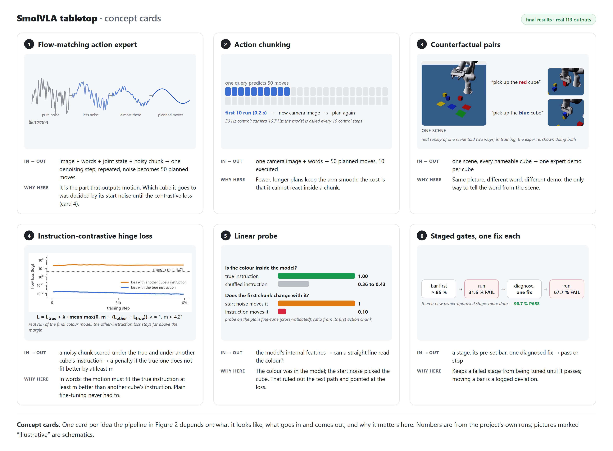

# REPORT — 113_vla_tabletop (cumulative)

## Status
Started 2026-10-01. **Final (2026-10-27): the project has ended.** Passed: 0A, 0B, 0C (every set, incl. the 2a /
2a-paired / Stage 4 / 2M / sizes / 3A / 3B data gates), Stage 1 (redesign #2, V15, 96.8 %), Stage 2M colours (test 11544
pick 96.7 %). Failed: Stage 2 merged (22.8 %), redesign (a) (early abort), 2a attempt 0 (36.8 %), 2a attempt 1 (31.5 %),
Stage 2R + its one fix (67.7 / 77.6 %; grounding fixed, precision not); sizes (2b after its one fix 68.1 %, round 2
79.4 %); 3A place (test 72.7 %, pick retention 90.2 %; its one fix stopped by its guard at 64.0 % on validation); 3B
stack (stopped at c075, 40.7 % on validation; no fix, stack dropped). Never run: Stage 4 SmolVLA seeds (3A kill as
written), pi0.5 (dropped). The no-language baseline stopped (overfit check failed) and is not a useful reference. Final
evaluation of S1 / 2M / the 3A checkpoint on the brief's splits (task 010, reported only): GATES "010 evaluation read",
`results/final_eval.json`, README "Final evaluation". PERUN 178.95 / 200 H200-h (`hpc/JOBS.md`).
See `status.txt`.

## Figures and demo (task 011)
Every number and image is real 113 output (sources: `figures/README.md`); schematic items are labelled illustrative.
Demo video `media/113_demo.mp4` (chapters in `media/clips/`): per skill the instruction templates, the success rule
generated from the evaluator's constants, the gate result, the first 16 episodes of a declared demo seed stream
(51000-51099, not selected, the evaluator's verdict per tile; `media/grids/*.json`) and one full-size episode with the
policy's own 224 px view. Viewer camera only; it never feeds the policy.

## Disclosures so far
- **0B.3 overfit attempt 0 VOID (instrument finding), 2026-10-01:** "consultant 113, 2026-10-01 ~21:15, under owner
  standing approval; reversible by the owner in the morning". Attempt 0 scored 36/100, but the pipeline was bit-exact
  and every grasped-never-lifted failure sat in demos where the expert lifted on a hidden 50-step timer (present in
  ~57 % of all expert grasps). The expert's lift gate was fixed (0A.2 documented expert fix 1 of 2: width-rate
  stillness), 0A.2 / 0A.3 re-validated on fresh test seeds, and 0B.3 re-run with the unchanged config. Batch 64 remains
  the one diagnosed 0B.3 fix. See GATES.md 18a2524.
- **0B.3 outcome and what the void bought (audit 2026-10-02, stated plainly for the owner's morning review):**
  re-run with fixed-expert demos and the unchanged batch-8 config FAILED 65/100 (0 never-lifted failures, same
  under-fit first chunk); attempt 1 (batch 64, the one diagnosed fix) PASSED 99/100. The expert defect explained the
  stall failures (11 of attempt 0's 64), not the bulk; voiding attempt 0 therefore granted one extra attempt, and the
  passing run differs from the original attempt 0 by two changes (expert fix booked to 0A.2 fix 1 of 2; batch 64 =
  0B.3's one fix). Without the void, attempt 1 would have been batch 64 on the old timer-laden demos (lead's estimate
  p(pass) ~ 0.28). Reversible by the owner. Entry arithmetic slip (samples_seen 320,000 vs 305,272) recorded as an
  erratum; the run executed the specified config exactly.
- **Demo labels relabelled (Stage 1's one fix), 2026-10-02 ~07:00, consultant 113 under owner standing approval,
  reversible by the owner:** sigma-0.1 per-step noise on a delta-on-hidden-target action makes the expert's clean labels
  carry a deadbeat correction the policy cannot see (Stage 1 attempt 0: pick 35.9 %). Fixed by labelling with the
  expert's setpoint step, r_t = clip(a_t + (x_{t-1} - a_{t-1})) on the arm dims. The pre-registered jitter clause was
  ruled met by its derivation ("the sigma-0 level": z 0.050 vs the noise-free expert's 0.046); the written estimate
  0.014-0.045 came from 10 demos.
- **Stage 1 attempt 1 FAIL, kill fired (2026-10-02):** pick 57.7 % (577/1,000) on test seed 11501 vs >= 90 % (slam 0.0 %, jam 0.9 % pass). The relabel removed the label jitter (val loss 0.48 -> 0.02) and lifted validation +19.7 points paired, but grasps still close on a rotated / off-centre cube that slips out. Stage 1's one fix is spent: the Stage 1 branch stops; Stages 2, 3A, 3B, 4 do not run; pi0.5's condition (Stage 2 PASS) cannot be met. Escalated to the robotics chat (blockers.md). Disclosure: "Stage 1 attempt 1 trains on relabelled demos (the expert's setpoint step instead of its clean label; HDF5 keeps both). The fix was chosen against four pre-registered qualification clauses. Three were met numerically. The fourth, label jitter 'at the σ = 0 level', measured z 0.050 against the written upper bound 0.045 and the matched noise-free expert's 0.046. It was ruled met by its derivation by consultant 113 under the owner's standing approval (reversible by the owner). D1's zero-noise sampling (48.7 % on validation) was not adopted."
- **Stage 1 kill fired (2026-10-02, 123b253):** attempt 1 (relabelled labels) test pick 57.7 % vs 90 -> Stage 1 branch
  stopped as written for the 128 px / N 20 design.
- **Stage 1 redesign by the owner (2026-10-02, "lets go with your recommendation", relayed by consultant 113), GATES
  b72947f:** image size 224 (was 128), chunk N 10 (was 20; N 5 only if the post-kill diagnosis shows it > 5 points
  better, rule written before reading it), training 48 epochs (was 24) — bundled on purpose; the gain cannot be
  attributed to any one change. Fresh test seed 11502; one fix allowed after it, then stop. pi0.5 stays dropped.
- **Stage 1 redesign result (2026-10-02, 00c1d56):** FAIL, test pick 68.3 % (bar 90; attempt 1 was 57.7 %), slam 0.0,
  jam 0.4; diagnosis: overfitting the 475 training trajectories (val loss rises while train loss falls), large cubes
  56.9 % vs small 79.3 %. Its one allowed fix (GATES b820931): demo count 500 -> 2,000, same steps, test seed 11503.
  If that fails, Stage 1 stops for good.
- **0C randomized Stage 4 set deferred** until the owner decides the randomizer's table palette (same decision).

- **Gate b820931 (Stage 1 redesign attempt 1, 2,000 demos) FAIL, 2026-10-02 (GATES.md d42beb0):** test seed 11503, 1,000
  episodes: pick 78.5 % (75.8-80.9) vs >= 90, slam 0.0 %, jam 0.2 %; validation 56.0 / 63.0 / 78.3 %, pick = 100 %
  checkpoint. Attempt cost 6.443 H200-h; PERUN 113 total 24.70.
- **Owner's Stage 1 redesign #2 decision (2026-10-02, disclosed):** gate bars unchanged; the task is made easier via cube
  spawn yaw +-15 deg / 0 deg (V15 / V0 variants); soft deadline 12:00 2026-10-03. Entry bdf1af2.
- **Gate 1 redesign #2 (owner): PASS for variant V15 (spawn yaw +-15 deg), 2026-10-03 (GATES.md c707676):** test seed
  11504, 1,000 episodes, run once: pick 96.8 % (968 / 1,000, 95.5-97.7) vs >= 90, slam 0.0 % (0.0-0.4) vs < 5, jam 0.2 %
  (0.1-0.7) vs < 2. Selection path: by a rule written before any number, V15 scored 94.3 % (92.7-95.6) on validation
  seed 21790, >= 90, so V15 was tested; V0 (99.9 % on the same validation) was never tested. Cost 13.358 H200-h
  (PERUN 113 total 38.06 of 100). Disclosure (verbatim from the RESULT): "After Stage 1's redesign and its one fix did
  not reach the bar (68.3 %, 78.5 %), the owner allowed an easier task: the single cube spawns with its yaw limited to
  +-15 deg (V15) or axis-aligned (V0) instead of any yaw. Both were trained in parallel with the same recipe (224 px,
  N 10, 2,000 relabelled demos, 41,328 steps); the harder variant passing on validation was tested first by a rule
  written before any number (V15 94.3 %, V0 99.9 % on validation 21790). Stage 1 PASSED on variant V15 (test seed
  11504): pick 96.8 % (95.5-97.7), slam 0.0 %, jam 0.2 %. The gate bars did not move. Stages 2-4 inherit the cube yaw
  range +-15 deg." Process disclosure: the lead committed in 000_infra (hpc_usage.md, 36fa2ae); that is the permitted
  ledger file but a commit outside this project repo.

- **Stage 2 FAIL, parked (2026-10-03 ~12:15):** test 11520 pick 22.8 % (20.3-25.5) vs bar >= 85, wrong-cube 39.8 % vs < 5, slam 0.0, jam 0.3; held-out 11530 pick 5.7 %. Diagnosis: the language path is intact, but the policy does not ground the instruction (closed loop with the true instruction vs shuffled: 28 vs 28). RESULT c8c5b15, erratum 12dfc9d, options memo `reports/2026-10-03-s2-grounding-options.md` (85092f2). 2a not started; 3A / 3B not launched (data ready, b906c90). Stage 2 used 7.15 H200-h; PERUN 113 total about 46.03 / 100.
- **Norm-table closure (2026-10-03):** accepted by the consultant with conditions (a) and (b) met: the served stats sha matches; std ratios 0.998 / 0.986 / 0.987.
- **Disclosure, duplicate jobs:** two watcher loops submitted duplicate c100 jobs, costing about 0.62 H200-h. The s100 of record is job 97546 at 24.3 %; its JSON was overwritten by duplicate 97550 at 24.0 %.
- **Disclosure, process error:** the Stage 2 overrun rule fired before the test job. The test was submitted on the orchestrator's "run as written" instruction without the dated re-plan line the rule requires. This is an orchestrator process error, recorded in the RESULT.
- **Stage 2 redesign (a) FAIL by early abort (2026-10-04 ~00:50, bdb9e2e):** option (a) = the same Stage 2 data and gate, U trainable set, initialised from `lerobot/smolvla_base` instead of the Stage 1 V15 checkpoint (34,440 steps). Early abort (d) fired on validation 21620: s_50 / s_75 / s_100 = 1.3 / 4.3 / 6.7 % (bar for continuing: s_50 > 5 %). Instruments I1–I4 passed; 11 failures looked at. Test seeds 11521 / 11531 were not used. Single-cube diagnosis (0b42108): the base-init run picks 23.7 % on one-cube scenes vs 87.7 % for the S1-init run, i.e. starting from the base model lost the motor skill. 5.748 H200-h.
- **Stage 2 redesign #2 = 2a then 2b (consultant decision under the owner's 24 h autonomy directive, 2026-10-04 ~02:00; context.md 170ed82; entries 3b6139e / c88a467):** Stage 2's pre-written fallback split is used: 2a = colours only (one cube size per scene), 2b = sizes; trainable set VT (vision + text + action expert) instead of U; init S1 V15. Bars unchanged (pick >= 85 %, wrong-cube < 5 %).
- **Stage 2a attempt 0 FAIL (2026-10-04 ~05:25, b019458):** test 11540 pick 36.8 % (33.9–39.8) vs >= 85, wrong-cube 34.0 % (31.1–37.0) vs < 5, slam 0.0, jam 0.4 %. By cube count 2 / 3 / 4: pick 56.6 / 28.7 / 21.3 % = the random-cube signature (chance 50 / 33 / 25 %); language check at 50 %: true 19 vs shuffled 17. The motor skill is present (expert / chunked ceiling 100 / 100 %); the cube choice ignores the instruction. 11 failures looked at. 9.018 H200-h.
- **Disclosure, 4×H200 deviation (2a attempt 0):** 2a was trained 4×H200 data-parallel, launched by the lead before the consultant's OK. The consultant's stated condition "GPU-h unchanged" did not hold: measured 4× rate 0.01065 vs the 1× VT rate 0.00709 GPU-s / sample = +2.25 H200-h for that training. Recorded as a deviation (consultant ruling ~03:10); since then any departure from a stated condition waits for a ruling first.
- **Stage 2a attempt 1 (in progress; GATES d33e371, the consultant's one pre-decided fix):** only the training data change, to counterfactual paired scenes: each sampled layout is demonstrated once per cube that is a valid target (same cube poses, pads and robot start; different instruction), 2,000 episodes in whole layout groups, split per layout. Test 11541 once; if it fails, Stage 2 is parked and 2b does not run. Disclosure text fixed in advance: "2a attempt 0 failed; its one diagnosed fix (attempt 1) changed only the training data to counterfactual paired scenes (each layout demonstrated with every cube as the target)."
- **Disclosure, item P instrument amendment (2026-10-04, c1c5988, consultant fallback, before any data-gate read):** the data check "t = 0 frames sha-identical within a layout group" is unreachable: the robot t = 0 state is bit-identical within groups, but the renderer gives a few-pixel difference per env slot (same episode in 16 slots: 3 distinct wrist shas, max 18 px values; median 4.5 differing pixels per pair in the data). Evaluation uses the same render path. The check was replaced by P1 (identical layout within 1e-6) + P2 (t = 0 state and env-slot assignment independent of the target, gated), with frame shas reported only.
- **Disclosure, PERUN block (2026-10-04 ~05:45):** the Stage 2 lead's PERUN job submissions were denied by the Claude Code permission classifier; attempt 1's remaining jobs wait for the owner (reports/blockers.md).

- **Session stop, 2026-10-04 ~09:31 → resumed 2026-10-24 20:48 UTC (orch 002):** the 2026-10-04 session died after
  submitting the 2a attempt 1 data checks (98302) and the baseline overfit evaluation (98305 / 98309). Their outputs
  were read on 2026-10-24 without re-running anything; ledger rows owed since then were added (113 total 65.20).
- **2a attempt 1 data gate PASS (3620bf4), read on 2026-10-24:** every 0C item and item P true; normalization tails the
  same as 2a attempt 0 and Stage 2 (same closure). Finding (reported, not gated): through the trainer's decode path
  the t = 0 wrist frames within a layout group differ more than the raw renders (median 1,584 differing px), consistent
  with per-episode h264 coding; evaluation frames are rendered, so it cannot reach a test number.
- **2a attempt 1 FAIL — Stage 2 stopped for good (df10928):** test 11541 pick 31.5 % (28.7–34.4) vs ≥ 85, wrong-cube
  33.8 % vs < 5; by cube count 49.6 / 27.0 / 16.8 %; among grasps the named cube 65 / 42 / 30 % vs 1 / n 50 / 33 / 25 %; paired probe: the named cube in 41.3 % of
  grasps (chance 34.8; attempt 0 34.6 % vs 35.1); language check true 21 vs shuffled 19. 14 failures looked at: wrong-
  colour clean grasps and closes on air beside cubes. Trained exactly as d33e371 (4×H200, 34,440 steps, 6.961 H200-h;
  every instrument passed). Consequence as written: no third 2a attempt; 2b, 3A, 3B and the Stage 4 SmolVLA seeds do
  not run. 2a attempt 1 cost 8.750 H200-h (line 8.81, cap 9.3); PERUN 113 total 73.76 / 130.
- **Post-kill grounding diagnosis (task 003; diagnosis, not an attempt; GATES 18970e1 + RESULT):** for 034440 and the
  S1 V15 init the target colour is linearly decodable (CV 1.000 vs shuffled 0.36–0.43) from the language tokens and
  from the K / V the action expert reads at layers 4–16, and (034440) from the image tokens by layer 16 (0.92); yet
  the first chunk ignores the instruction (instruction effect / start-noise effect 0.103 / 0.084 ≤ 1.5; the data's own
  instruction effect is 16× the policy's) → **R3 data / loss**. 0.120 H200-h; PERUN 113 total 73.88 / 130.
- **Inference-time guidance probe (task 004; diagnosis on validation, not an attempt; GATES 8c9ad87 + RESULT):**
  034440's velocity guided toward the true instruction and away from the mean of the other cubes' instructions,
  v_other + w (v_true − v_other) at every denoising step, on validation 21640 eps 0–299: pick w = 1 / 2 / 4 / 8 =
  28.7 / 29.7 / 29.0 / 26.7 % (w = 1 reproduces s_100 28.0 %), wrong-cube 38 → 34 %, chance × skill pattern by cube
  count at every w → **no effect**. Guidance raises the instruction's pull on the first chunk ~linearly (step 2
  ratio 0.10 → 0.51 at w = 8) but the start noise still moves it 2× more. The other-cube instructions use the
  simulator's scene list (privileged, disclosed). 1.081 H200-h (line 1.0, cap 1.5); PERUN 113 total 74.96 / 130.
- **Stage 2R — instruction-contrastive flow loss (task 005; owner-approved redesign; GATES 684251b + RESULTs fa99e45 /
  c782a7c):** 2a attempt 1's recipe and data, init its 034440, plus L = L_true + λ · mean max(0, m − (L_other − L_true)),
  L_other = the same x_t / t / ε scored under another member's instruction, λ 1, m 4.2103 (pre-registered rule).
  Consultant rulings: early abort (b) read on the optimized objective (converged init); the one fix = more steps (+34,440
  from 2R 034440, (b) replaced by c050 regression / grounding guards). Results (bars pick ≥ 85, wrong-cube < 5, slam < 5,
  jam < 2): **attempt 11542 pick 67.7 %** (wrong 3.5, slam 1.3, jam 0.1); **fix 11543 pick 77.6 %** (wrong 3.9, slam 0.5,
  jam 0.7) → FAIL on pick → **Stage 2 closed for good**. Grounding fixed: paired probe named cube 93.6 / 95.5 % of grasps
  (chance 35; 2a a1 41.3 %), same cube regardless 0 / 52 and 0 / 72 groups; step-2 instruction / noise ratio 0.10 → 2.2.
  Residual = grasp precision (24 failures looked at: closes a few cm off the named cube, edge grasps drop). 20.94
  H200-h (attempt 10.415 + fix 10.522); PERUN 113 total 95.90 / 160 (owner raised the cap 130 → 160 on 2026-10-25).
- **Stage 2M — grasp precision on the grounded policy (task 006; new owner-approved stage, not a third Stage 2
  attempt; GATES f3c983b + RESULTs abf47d8 / 3b41e7e / d8c91a8):** the Stage 2R fix checkpoint trained 68,880 more steps
  at lr 5e-5 with the same instruction-contrastive loss (λ 1, m 4.2103) on 6,000 paired demonstrations (Stage 2R's
  2,000 + 4,000 new layouts of seed 32800, groups 1100–3299; the union provably only adds data). Validation 21640:
  91.7 / 97.0 / 98.3 %. **Test 11544: pick 96.7 % (95.4–97.6), wrong-cube 0.1 %, slam 0.1 %, jam 0.5 % → PASS.** By cube
  count 2 / 3 / 4: 98.8 / 95.9 / 95.6 %. Paired probe 21645: named cube 99.5 % of grasps (chance 34 %), same cube
  regardless 0 / 83 groups. 20.50 H200-h (line 19.82; the c100 job hit its limit in the reported-only offline-MAE step,
  so that item is missing); PERUN 113 total 116.76 / 160 with the 2b collects.
  - *Disclosure, train / test separation:* test and training scenes come from separate seed streams of the same sampler
    (data 32800, test 11544, validation 21640, probe 21645). Beyond the separate seeds, the data audit
    (`tests/test_data_audit.py::audit_dataset`, run in every data gate) regenerates every training episode and flags any
    scene (same cube set and layout within 1 mm / 1°, whatever the target) equal to episodes 0–999 of any assigned test /
    validation stream, including s2a 11540–11549; the 2M training set had 0 violations (132204).
- **2b amended — sizes (task 006; GATES 3862001 + RESULTs 7e69b25 / 577d2f8 / ceb7e05 / 9fd1542 / f3d77eb / d3c3487):** paired s2
  data (seed 32900, colours + sizes, 2–5 cubes, 4,000 episodes) + the contrastive loss (m 4.2989), 34,440 steps at lr 5e-5
  from the 2M pick. Attempt: guard (b1) fired at c050 (pick 60.7 %, slam 17.7 % induced by training; the init itself:
  pick 69.0 %, wrong-cube 18.3 %, slam 0.7 % on s2 validation). One fix (consultant): the full schedule, guards at c075
  (init − 5, slam > 10 %): validation 57.3 / 66.3 / 70.7 %; **test 11551 pick 68.1 % (bar 85) → FAIL**; wrong-cube 4.4 %
  (43 / 44 same colour other size), slam 9.4 %; held-out 11561 44.3 %. 2b closed; Stage 2 = colours PASS, sizes FAIL.
  17.76 H200-h; PERUN 113 total 135.28 / 160.
- **2b sizes round 2 (task 008, owner's "1"; GATES RESULTs a0ba0dd / 4f00931 / 0a87f99 / cdbcbfb / 990b791 / e0d8fee):**
  +8,000 paired s2 demos (union 12,000, m 4.2907), 68,880 steps at lr 5e-5 from the 2b fix pick. Guards pass (c050
  wrong-cube 3.3 %; c075 pick 80.0 %, slam 9.3 %); validation 69.3 / 80.0 / 81.0 %, pick 068880. **Test 11552 pick 79.4 %
  (bar 85) → FAIL**; wrong-cube 2.6 % (26 / 26 same colour other size), slam 9.1 %, jam 0.8 %; by cubes 91 / 84 / 72 / 70 %;
  held-out 11562 45.3 %; probe named cube 95.0 % of grasps. 12 failures looked at: wild reaches into the table (6), closes
  beside the target (3), edge grasp + drop (2), size (1). Sizes closed for good; 009 = place / stack one size per scene
  from the 2M pick. 21.97 H200-h; PERUN 113 total 157.25 / 160.
- **Baseline stopped; "the no-language baseline is not a useful reference in 113" (fa18efc, erratum 2489d48):** the
  overfit capacity check (100 training episodes, 300 epochs) scored 0 / 100 on its own training scenes (bar 80 %) →
  the entry's "model / pipeline bug" reading → no fix run, no test episode. Its training loss on those episodes fell
  1.50 → 0.03 (the RESULT first misread a validation loss of 0.085 as the training-scene loss; corrected by erratum).
  A read-only code look (laptop CPU) found no bug: images reach the head, and the same network learns an image-only
  target on synthetic scenes. Likely cause, not verified: 112's network had the cube position in its state; 113's brief
  removed it.

- **Stage 3, one cube size per scene (task 009; owner's "1", GATES 588b9f6 + RESULTs; report
  `reports/2026-10-27-009-stage3.md`):** disclosure (verbatim): "colours only = one cube size per scene; size words may
  appear but never disambiguate; 2–4 cubes (one size has 4 colours)". From the 2M pick (068880), paired data + the
  contrastive loss, 35,508 steps at lr 5e-5, 1×H200 per stage. **3A FAIL:** test 11580 place 72.7 % (69.9–75.4) vs 80,
  wrong pad 0.2 %; pick retention 11544 90.2 % (88.2–91.9) vs 91.7 (−6.5 points paired vs 2M); probe named cube 289 / 289
  of grasps, named pad 246 / 246 of releases. **3B FAIL:** stopped at c075 by both guards (stack 40.7 % < 55 %, slam
  12.3 % > 10 %); no fix (consultant ruling), stack dropped from the final. Failures looked at are motor (grasp centring,
  releases, transit drops, wild reaches); 3A place grounding is complete by its probe, 3B was not probed (wrong target
  7.3 % at c075; one destination confusion and one wrong object among its frames).
  - *I2 ruling (consultant 113, 2026-10-27, reversible by owner):* the inherited union I2 cannot pass for a task new to
    the init (union 4.468 / 2.992); read on the init's pick stream: 0.0117 ≤ 0.10, base-model mutant 0.3755 flagged.
  - *check_iii:* the post check's pass flag also demands whole epochs; `--max-steps` ended 008 and 009 short of an epoch
    boundary, so it is false with 0 steps differing (3A: 0 / 35,508); read as steps differing.
  - *3A data gate:* a `paired_check` defect (ignored the export's per-stream kept override) stopped the gate; fixed with a
    test (6595627), resumed; data and thresholds untouched.
  - *3A one fix (consultant, 2026-10-27, reversible by owner):* supersedes the 3A test FAIL's "branch stops": +17,754 steps
    from the 3A pick, lr 5e-5 restarted. Its guard fired at the first save (place validation 64.0 % < 70 %; the init read
    75.0 % on the same seeds; pick 83.3 vs 88.7 %); 3A closed for good. Reading: restarting the lr on a converged
    checkpoint pulled it off its best point.
- **PERUN cap (owner):** 130 → 160 on 2026-10-25 ("raise to 160 - even to 180 if you think it will get good results");
  180 taken up on 2026-10-26 for task 009 on the consultant's written projection; 180 → 200 on 2026-10-27 ("up the limit
  to 200h").
- **Final evaluation (task 010; reported only, no training, no gate, no kill; GATES "010 evaluation read", jobs
  135312–135315):** S1, 2M and the 3A checkpoint (labelled FAIL) on (a) seen, (b) randomized visuals — out of distribution
  for every model, (c) held-out combinations — n/a for 3A place (`heldout_comp` undefined for the one-size sampler), not in
  the table for S1, (d) paraphrases; 1,000 episodes per cell on fresh seeds registered before any job. Readings: (b)
  collapses every model; 2M (c) 17.7 % with every wrong grasp on one specific cube (yellow → green-small 330 / 330,
  green → yellow-large 313 / 313); 3A pick under paraphrases 12.2 % (grasps, then drop 574). 3.32 + videos 0.485 = 3.80 H200-h; 113 =
  178.95 / 200.

## Needs you
- **Nothing blocking; the project has ended.** Whether to open a new brief is the owner's call. If one targets the motor
  side, the 009 frames point at release precision / timing and grasp centring in clutter, not at the language.
- **Optional review of reversible rulings:** the consultant rulings marked "reversible by owner" in the `context.md`
  deviation log stand unless you reverse them; the 0B.3 option-A decision (void + expert fix, 2026-10-01) still asks for
  your confirmation or reversal.
- ~~**PERUN submissions for the Stage 2 lead (2026-10-04):** blocked by the permission classifier.~~ Resolved (owner
  unblocked, 12dfb63).
- ~~**Stage 2 parked (2026-10-03)**, the s4r palette, the Stage 4 budget:~~ Resolved (consultant option (a) then 2a / 2b;
  palette decided 2026-10-03; Stage 4 not run).
- ~~Robotics chat / owner: Stage 1 kill fired (attempt 1 FAIL, 57.7 %).~~ Resolved: Stage 1 redesign #2 (V15) PASSED (c707676).
- ~~pi0.5 tokenizer licence / token:~~ moot (pi0.5 dropped, project ended).

## Questions for the robotics chat
- **(Ruled by consultant 2026-10-02 ~07:00 under standing approval: relabel approved; reversible.)** Stage 1 parked. Attempt 0 failed (pick 35.9 %, bar
  90) because the sigma-0.1 demo noise leaves ~0.1 white jitter in the labels (the expert's next label cancels the hidden
  target offset of the previous noise). The relabel fix (labels = the expert's setpoint step) passes 3 of 4
  pre-registered checks decisively (slope gone, executable 128/128, val loss 0.032 vs 0.481) and misses the z jitter
  clause by 0.005 (0.050 vs 0.045 written; the noise-free expert itself is 0.046). Recommend: approve the relabel as the
  one fix (relabel + re-gate all 0C sets, then attempt 1). Alternatives: sigma = 0 (design change) or stop Stage 1.
- **(Decided by consultant 2026-10-01 ~21:15 under standing approval: option A; reversible in the morning.)** 0B.3 overfit, attempt 1 held. See `reports/blockers.md` 2026-10-01 row:
  the expert's 50-step close timeout puts a hidden clock in 7/10 overfit demos. Option A (recommended): fix the expert's
  lift trigger (0A.2 documented fix 1 of 2), re-validate 0A.2/0A.3, void 0B.3 attempt 0 as an instrument finding,
  keep batch 64 as the one diagnosed fix. Option B: run batch 64 now on the current demos (p(pass) ~ 0.28 by the
  lead's estimate) and accept the kill if it fails.
- 0A.3 emulation reading (resolved by the owner 2026-10-01: option a).
- (non-blocking, GATES bf026f2) If 3A (place) fails after its one fix, GATES stops Stage 4 too (the brief calls only 3B
  "not a project stop"). Intended, or should Stage 4 run pick + stack without place?
- (non-blocking) Stage 4 split (b) "randomized visuals" = the TRAINING randomizer band; the held-out visual band is an
  extra reported split (b'), ~1.3 GPU-h from reserve. Correct reading?
- (non-blocking) The 112 table-hue train bands include red / yellow / green tables (low contrast with same-colour
  cubes/pads); kept per the brief ("112 randomizer with its tested split").
